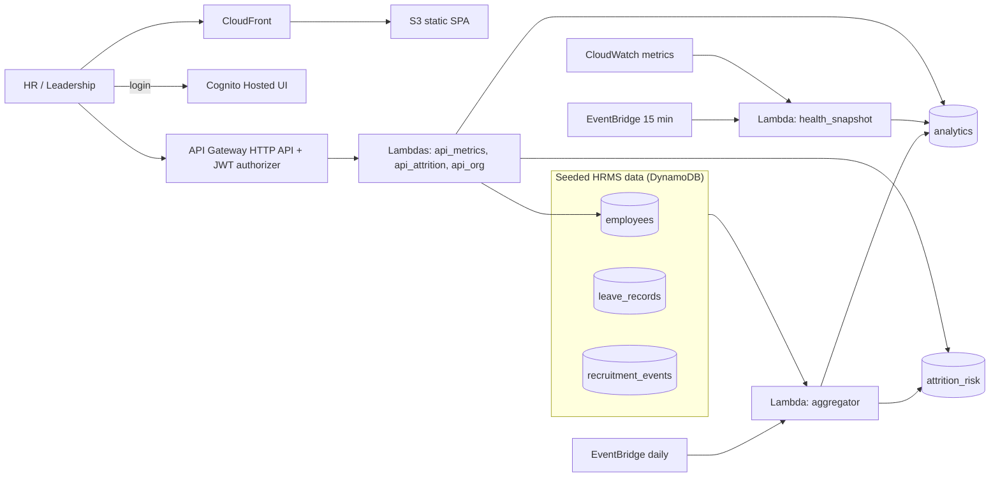

# Workforce Analytics & Org Intelligence Dashboard

**A production-deployed, serverless analytics layer that turns raw HR data into decisions.**
A daily pipeline aggregates workforce metrics and computes a transparent attrition-risk score per employee. A Cognito-protected dashboard visualises headcount, leave, recruitment and risk, with an interactive org chart and a live system-health panel. Everything is infrastructure-as-code, deployed through CI/CD using GitHub OIDC, and designed to run inside the AWS free tier.

| | |
|---|---|
| **Status** | Phase 0-2 (planning and foundation). See [`docs/06-sdlc-roadmap.md`](docs/06-sdlc-roadmap.md) |
| **Region** | `ap-south-1` (Mumbai) |
| **Cost target** | $0 (AWS free tier). See [`docs/08-free-tier-guardrails.md`](docs/08-free-tier-guardrails.md) |
| **Team** | [@amit-cloudops-ai](https://github.com/amit-cloudops-ai) (lead), [@sush-kush](https://github.com/sush-kush), [@dggk78](https://github.com/dggk78) |

## What it shows

- **Headcount trend:** monthly hires vs departures per department
- **Leave utilisation:** % of leave quota used per department, current month vs 3-month average
- **Recruitment funnel:** received → shortlisted → interviewed → offered → joined
- **Attrition risk:** top 10 employees by risk score with contributing factors
- **Live org chart:** interactive tree built from `manager_id`
- **System health:** API Gateway request counts and Lambda errors

## Architecture



Full detail: [`docs/02-architecture.md`](docs/02-architecture.md)

## Repository map

| Path | Purpose |
|---|---|
| `docs/` | The full plan: charter, requirements, architecture, data model, scoring, API contract, roadmap, runbook |
| `docs/adr/` | Architecture Decision Records |
| `infra/` | Terraform (`bootstrap/`, `envs/dev`, `envs/prod`, `modules/*`) |
| `services/` | Lambda code (`aggregator`, `health_snapshot`, `api_*`, `shared`) |
| `data/` | Deterministic seed script and fixtures |
| `frontend/` | Static single-page dashboard (Chart.js + D3 via CDN) |
| `tests/` | `unit/`, `contract/`, `golden/` |
| `scripts/` | `verify.sh`, `package.sh`, `create_github_issues.py` |
| `AGENTS.md` | **Rules every AI/human contributor must follow** |

## Start here

1. Read [`docs/00-project-charter.md`](docs/00-project-charter.md) (goal and finish line).
2. Read [`docs/07-team-and-workstreams.md`](docs/07-team-and-workstreams.md) and claim a workstream.
3. Read [`AGENTS.md`](AGENTS.md) and [`docs/CHATGPT_BUILDER_PLAYBOOK.md`](docs/CHATGPT_BUILDER_PLAYBOOK.md) before using ChatGPT on any task.
4. Pick an issue from the board (backlog: [`docs/BACKLOG.md`](docs/BACKLOG.md)).
5. Run `make verify` before every push.

## Quick commands

```
make help      # list targets
make verify    # repo structure + contract + lint + tests + terraform validate
make package   # build Lambda zips into build/
make seed ENV=dev   # seed DynamoDB (once the seed script exists)
```

## Attrition risk score (summary)

`risk = 0.40 x performance + 0.35 x leave + 0.25 x tenure` → Low 0-39, Medium 40-64, High 65-100.
Inputs, weights and thresholds are documented in [`docs/04-scoring.md`](docs/04-scoring.md). It is a transparent heuristic on **dummy data**, not a predictive model.

## License

MIT. See [`LICENSE`](LICENSE).
