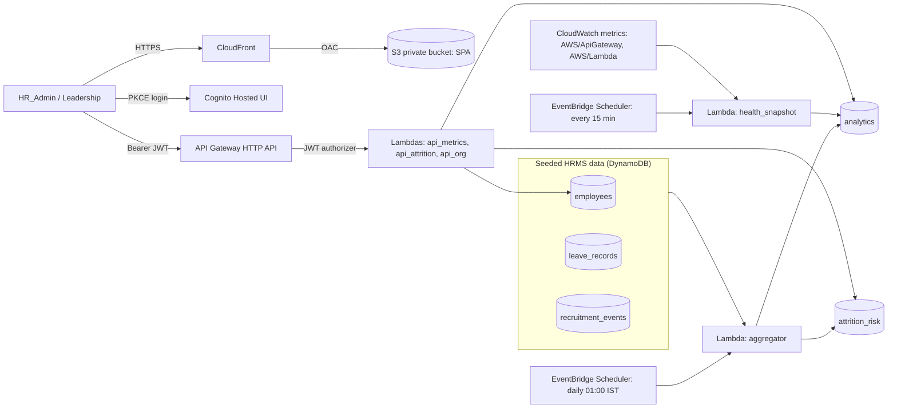

# 02. Architecture

## Data flow

## Components
| Component | Service | Notes |
|---|---|---|
| Source tables | DynamoDB | `employees`, `leave_records`, `recruitment_events`, seeded; stand-in for HRMS microservices |
| Aggregator | Lambda (python3.12) | Reads source, writes `analytics` and `attrition_risk`; idempotent; accepts `{"as_of": "YYYY-MM-DD"}` |
| Scheduler | EventBridge Scheduler | Daily aggregation; 15-min health snapshot |
| Health snapshot | Lambda | Reads CloudWatch `GetMetricData`, writes `sys_*` metrics to `analytics` with TTL |
| API | API Gateway HTTP API + Lambda | 6 GET endpoints, JWT authorizer, throttling, CORS limited to CloudFront domain |
| Auth | Cognito user pool | Groups `HR_Admin`, `Leadership`; Hosted UI; auth-code + PKCE; no client secret |
| Frontend | S3 (private) + CloudFront (OAC) | HTTPS, security-headers policy, `config.json` generated at deploy |
| Observability | CloudWatch Logs/Metrics/Alarms + SNS | 14-day log retention, alarms to email |
| IaC / CI-CD | Terraform + GitHub Actions (OIDC) | State in S3 with native locking |

## Environments
`dev` and `prod` in the **same AWS account**, isolated by naming (`wfa-dev-*`, `wfa-prod-*`) and separate Terraform state keys. Prod deploys only from `v*` tags with manual approval.

## Naming
`wfa-<env>-<thing>`, e.g. `wfa-dev-employees`, `wfa-prod-aggregator`, `wfa-dev-api`. Tags on everything: `Project=workforce-analytics-platform`, `Env=<env>`, `ManagedBy=terraform`.

## Terraform outputs contract (do not rename)
Root outputs of `infra/envs/<env>` that CI and the frontend depend on:

| Output | Used by |
|---|---|
| `frontend_bucket` | deploy workflow (S3 sync) |
| `cloudfront_distribution_id` | deploy workflow (invalidation) |
| `cloudfront_domain` | `config.json` `siteUrl`, Cognito callback URL |
| `api_url` | `config.json` `apiUrl` |
| `cognito_user_pool_id` | smoke test, runbook |
| `cognito_client_id` | `config.json` `clientId` |
| `cognito_domain` | `config.json` `cognitoDomain` (full hosted-UI base URL, `https://...`) |
| `sns_alert_topic_arn` | monitoring |

## Lambda packaging contract
`services/<function>/handler.py` + `services/shared/` → `build/<function>.zip` via `scripts/package.sh`. Entrypoint `handler.lambda_handler`. Terraform references `build/<function>.zip`. Functions: `aggregator`, `health_snapshot`, `api_metrics`, `api_attrition`, `api_org`.

## Lambda configuration
Runtime `python3.12`, arch `arm64`, memory 256 MB (aggregator 512 MB), timeout 10 s (API) / 120 s (aggregator), log retention 14 days, reserved concurrency not set (avoid account-limit issues), one IAM role per function with least privilege.

## IAM least privilege (per function)
| Function | Allowed |
|---|---|
| aggregator | `dynamodb:Scan/Query/GetItem` on source tables; `PutItem/BatchWriteItem` on `analytics`, `attrition_risk`; logs; `cloudwatch:PutMetricData` is **not** needed (EMF via logs) |
| health_snapshot | `cloudwatch:GetMetricData`; `dynamodb:PutItem` on `analytics`; logs |
| api_metrics | `dynamodb:Query` on `analytics`; logs |
| api_attrition | `dynamodb:Query` on `attrition_risk`; logs |
| api_org | `dynamodb:Scan` on `employees`; logs |

## Security controls
- S3 bucket private, Block Public Access on, access only via CloudFront OAC.
- CloudFront: redirect HTTP→HTTPS, TLS 1.2+, response headers policy (HSTS, X-Content-Type-Options, X-Frame-Options, Referrer-Policy, CSP allowing only self + pinned CDNs + the API/Cognito origins).
- API: JWT authorizer on every route; Lambda re-checks `cognito:groups`; throttling (burst 20, rate 10 rps).
- DynamoDB: encryption at rest with AWS-owned key (default, free); no public access.
- No secrets exist in the system (no Secrets Manager needed).

## Observability and SLOs
| SLI | SLO | Alarm |
|---|---|---|
| API availability (non-5xx / total) | 99.5% monthly | API 5xx ≥ 5 in 5 min |
| API latency p95 | < 800 ms | informational |
| Aggregator success | 1 success per 26 h | `AggregatorSuccess` metric missing / 0 for 26 h |
| Lambda errors | 0 | any function `Errors ≥ 1` in 5 min |
| Spend | $0 | AWS Budget $1 actual + forecast |

Custom metrics are emitted with **CloudWatch Embedded Metric Format** from the aggregator (`EmployeesProcessed`, `MetricsWritten`, `AggregatorSuccess`), keeping within the 10 free custom metrics.

## Decisions
See [`adr/`](adr/).
